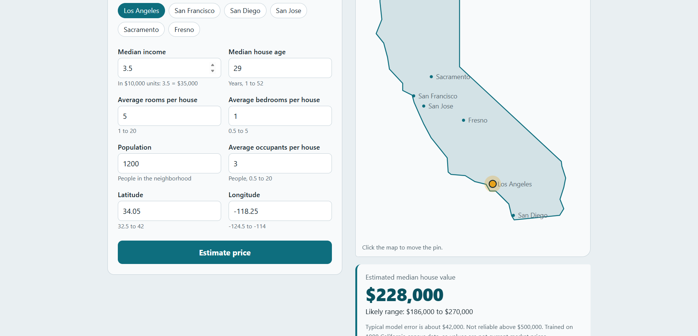

# California House Price Predictor

An end-to-end machine learning project: exploring the California Housing dataset, comparing regression models, and serving the best one through a small web app.


## What's inside

| File | Purpose |
|---|---|
| `house_price.ipynb` | Full workflow: EDA, cleaning, train/test split, model comparison, tuning, evaluation |
| `house_price_model.joblib` | Final trained model (Gradient Boosting) |
| `server.py` | Flask backend that loads the model and exposes `/predict` |
| `index.html` | Frontend: form, interactive California map, and price estimate |
| `app.py` | Alternative Streamlit interface (optional) |
| `requirements.txt` | Python dependencies |

## Results

Test set: 3,915 neighborhoods (20% split, `random_state=42`). Target is the median house value in units of $100,000.

| Model | RMSE | R² |
|---|---|---|
| Linear Regression (baseline) | 0.616 | 0.609 |
| Random Forest | 0.471 | 0.772 |
| Random Forest (tuned) | 0.466 | 0.776 |
| **Gradient Boosting (early stopping)** | **0.423** | **0.816** |

Typical error of the final model is about $42,000.

## Workflow

1. **EDA:** 20,640 rows, no missing values. The target is right-skewed and capped at 5.0; median income is the strongest predictor.
2. **Cleaning:** removed rows with a capped price (`MedHouseVal >= 5`) and extreme outliers (`AveRooms > 20`, `AveOccup > 20`), leaving 19,571 rows.
3. **Models:** linear regression, random forest (with randomized search and cross-validation), and histogram-based gradient boosting.
4. **Overfitting check:** the default random forest scored R² 0.97 on training data versus 0.77 on test data. Gradient boosting with early stopping generalized much better.

## Run it locally

```bash
pip install -r requirements.txt
python server.py
```

Then open <http://127.0.0.1:5000> in your browser. Do not open `index.html` directly; it needs the backend.

## Limitations

- The data comes from the **1990 US census**, so predicted values are not current market prices.
- Each row is a **neighborhood**, not an individual house.
- Prices above $500,000 were removed because they are capped in the data; the model is not reliable in that range and tends to under-predict expensive areas.
- Several models were compared on the same test set, so the final score is slightly optimistic.

## Ideas for future work

- Retrain on current listing data fetched online for up-to-date prices.
- Add feature engineering (for example distance to the coast or to major cities).
- Try XGBoost or LightGBM and compare with cross-validation.
